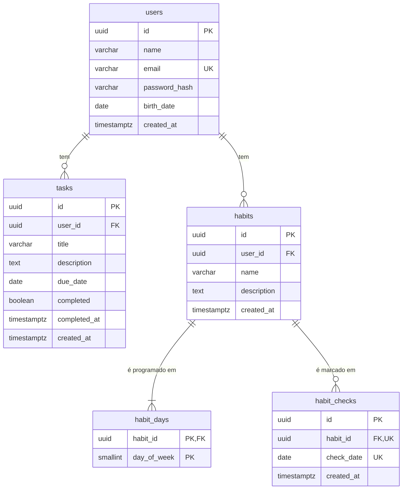

# Banco de dados

O AstroBit usa **PostgreSQL 18**: localmente durante o desenvolvimento e no [Neon](https://neon.com) em produção. As tabelas são criadas e versionadas por migrations do **Flyway**, nunca à mão.

O diagrama editável está em [`banco-de-dados.pgerd`](./banco-de-dados.pgerd) e pode ser aberto no **ERD Tool** do pgAdmin 4.

## Sumário

- [Diagrama](#diagrama)
- [Convenções](#convenções)
- [Tabelas](#tabelas)
  - [users](#users)
  - [tasks](#tasks)
  - [habits](#habits)
  - [habit_days](#habit_days)
  - [habit_checks](#habit_checks)
- [Relacionamentos](#relacionamentos)
- [Regras garantidas pelo back-end](#regras-garantidas-pelo-back-end)

## Diagrama

## Convenções

| Item | Padrão | Exemplo |
| --- | --- | --- |
| Tabelas | inglês, plural, `snake_case` | `habit_checks` |
| Colunas | inglês, `snake_case` | `created_at` |
| Chave primária | `id` do tipo `uuid`, gerado com `uuidv7()` | `id` |
| Chave estrangeira | tabela no singular + `_id` | `user_id` |
| Primary key | `pk_<tabela>` | `pk_users` |
| Foreign key | `fk_<tabela>_<referência>` | `fk_tasks_user` |
| Unique | `uq_<tabela>_<colunas>` | `uq_users_email` |
| Check | `ck_<tabela>_<coluna>` | `ck_habit_days_day_of_week` |
| Índice | `idx_<tabela>_<coluna>` | `idx_tasks_user_id` |

**Tipos de data:**

- `timestamp with time zone` para momentos exatos (`created_at`, `completed_at`).
- `date` para datas que são só o dia (`birth_date`, `due_date`, `check_date`).

**Por que UUIDv7:** os ids aparecem nas URLs da API, e um UUID não pode ser adivinhado como um número sequencial. A versão 7 é ordenada pelo tempo, o que mantém os índices eficientes, e o PostgreSQL 18 gera esse tipo de id nativamente.

## Tabelas

### users

Contas de usuário.

| Coluna | Tipo | Nulo | Padrão | Descrição |
| --- | --- | :---: | --- | --- |
| `id` | `uuid` | não | `uuidv7()` | Identificador |
| `name` | `varchar(100)` | não | | Nome do usuário |
| `email` | `varchar(150)` | não | | E-mail de login, salvo em minúsculas |
| `password_hash` | `varchar(100)` | não | | Hash BCrypt da senha (nunca a senha pura) |
| `birth_date` | `date` | não | | Data de nascimento |
| `created_at` | `timestamptz` | não | `now()` | Data de criação da conta |

| Constraint | Tipo | Definição |
| --- | --- | --- |
| `pk_users` | Primary key | `(id)` |
| `uq_users_email` | Unique | `(email)` |

### tasks

Tarefas do usuário. Toda tarefa tem uma data.

| Coluna | Tipo | Nulo | Padrão | Descrição |
| --- | --- | :---: | --- | --- |
| `id` | `uuid` | não | `uuidv7()` | Identificador |
| `user_id` | `uuid` | não | | Dono da tarefa |
| `title` | `varchar(150)` | não | | Título |
| `description` | `text` | sim | | Descrição opcional |
| `due_date` | `date` | não | | Data da tarefa |
| `completed` | `boolean` | não | `false` | Se foi concluída |
| `completed_at` | `timestamptz` | sim | | Quando foi concluída |
| `created_at` | `timestamptz` | não | `now()` | Data de criação |

| Constraint | Tipo | Definição |
| --- | --- | --- |
| `pk_tasks` | Primary key | `(id)` |
| `fk_tasks_user` | Foreign key | `(user_id)` → `users(id)`, `ON DELETE CASCADE` |

| Índice | Colunas | Motivo |
| --- | --- | --- |
| `idx_tasks_user_id` | `(user_id)` | Toda listagem filtra pelo usuário |

### habits

Hábitos do usuário.

| Coluna | Tipo | Nulo | Padrão | Descrição |
| --- | --- | :---: | --- | --- |
| `id` | `uuid` | não | `uuidv7()` | Identificador |
| `user_id` | `uuid` | não | | Dono do hábito |
| `name` | `varchar(100)` | não | | Nome do hábito |
| `description` | `text` | sim | | Descrição opcional |
| `created_at` | `timestamptz` | não | `now()` | Data de criação |

| Constraint | Tipo | Definição |
| --- | --- | --- |
| `pk_habits` | Primary key | `(id)` |
| `fk_habits_user` | Foreign key | `(user_id)` → `users(id)`, `ON DELETE CASCADE` |

| Índice | Colunas | Motivo |
| --- | --- | --- |
| `idx_habits_user_id` | `(user_id)` | Toda listagem filtra pelo usuário |

### habit_days

Dias da semana em que cada hábito está programado. Os outros dias contam como **folga** e não quebram a sequência.

| Coluna | Tipo | Nulo | Padrão | Descrição |
| --- | --- | :---: | --- | --- |
| `habit_id` | `uuid` | não | | Hábito |
| `day_of_week` | `smallint` | não | | Dia da semana: 1 (segunda) a 7 (domingo) |

| Constraint | Tipo | Definição |
| --- | --- | --- |
| `pk_habit_days` | Primary key composta | `(habit_id, day_of_week)`: o mesmo dia não se repete no hábito |
| `fk_habit_days_habit` | Foreign key | `(habit_id)` → `habits(id)`, `ON DELETE CASCADE` |
| `ck_habit_days_day_of_week` | Check | `day_of_week BETWEEN 1 AND 7` |

### habit_checks

Registro de cada dia em que o hábito foi cumprido.

| Coluna | Tipo | Nulo | Padrão | Descrição |
| --- | --- | :---: | --- | --- |
| `id` | `uuid` | não | `uuidv7()` | Identificador |
| `habit_id` | `uuid` | não | | Hábito |
| `check_date` | `date` | não | | Dia cumprido |
| `created_at` | `timestamptz` | não | `now()` | Momento da marcação |

| Constraint | Tipo | Definição |
| --- | --- | --- |
| `pk_habit_checks` | Primary key | `(id)` |
| `fk_habit_checks_habit` | Foreign key | `(habit_id)` → `habits(id)`, `ON DELETE CASCADE` |
| `uq_habit_checks_habit_date` | Unique composta | `(habit_id, check_date)`: um hábito só é marcado uma vez por dia |

## Relacionamentos

| Origem | Destino | Tipo | Ao apagar a origem |
| --- | --- | --- | --- |
| `users` | `tasks` | 1:N | Apaga as tarefas |
| `users` | `habits` | 1:N | Apaga os hábitos |
| `habits` | `habit_days` | 1:N | Apaga os dias programados |
| `habits` | `habit_checks` | 1:N | Apaga o histórico |

Apagar uma conta remove todos os dados do usuário em cascata.

## Regras garantidas pelo back-end

Algumas regras dependem de mais de uma tabela ou da data atual, então o banco não consegue verificá-las sozinho. Elas ficam na camada de serviço da API:

- Todo hábito precisa de **pelo menos um** dia programado.
- Um hábito só pode ser marcado em um **dia programado**.
- O e-mail é convertido para **minúsculas** antes de salvar, para que `Ana@Email.com` e `ana@email.com` não virem duas contas.
- Cada usuário só acessa as **próprias** tarefas e hábitos.
